
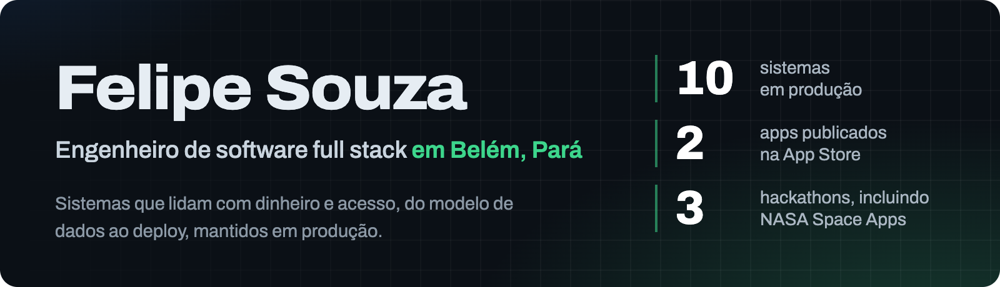

Construo sistemas que lidam com dinheiro e controle de acesso: bilheteria, assinaturas, SaaS multi-tenant, pagamentos e IA aplicada. Cuido do caminho inteiro, do modelo de dados ao deploy, e mantenho em produção o que entrego.

A maior parte do meu código é de clientes e fica em repositórios privados. Os estudos de caso explicam arquitetura, decisões e resultados sem expor código ou dados de ninguém.

## Hackathons

<table>
<tr>
<td width="33%" valign="top">

<a href="https://amazviva.online">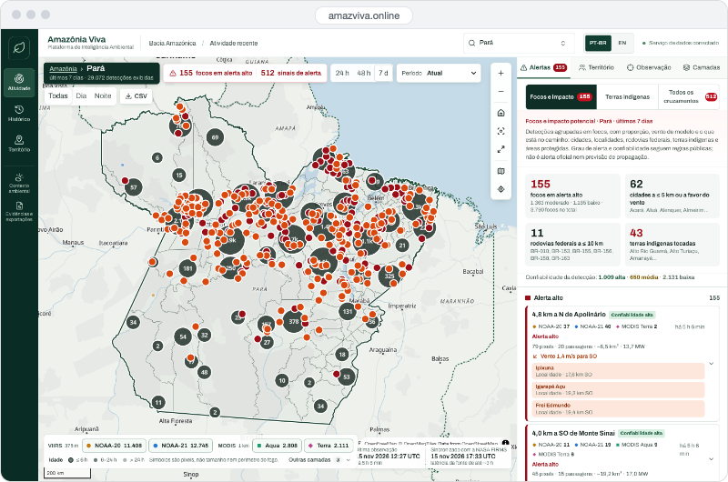</a>

**Amazônia Viva** 

Detecções de fogo por satélite viram contexto territorial: histórico MODIS × VIIRS harmonizado, anomalias por município e quem pode ser afetado.

    

[Demo](https://amazviva.online) · [Código](https://github.com/filpe19/amazonia-viva)

</td>
<td width="33%" valign="top">

<a href="https://patrion.online">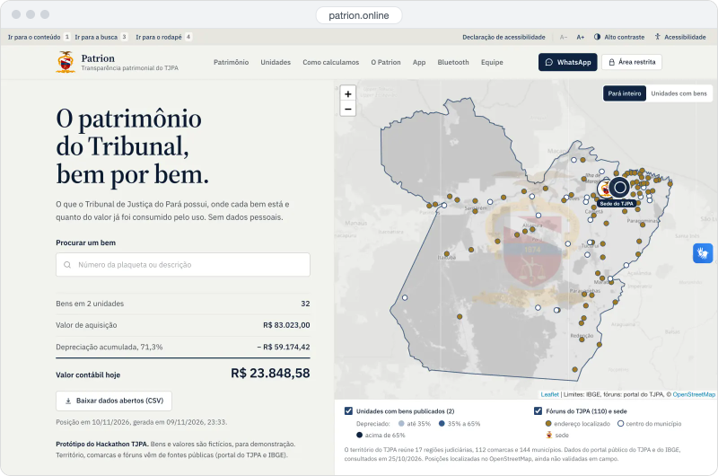</a>

**Patrion** 

Inventário patrimonial para o Tribunal de Justiça do Pará: app offline-first, sincronização idempotente, auditoria imutável e portal de transparência. Feito em dupla.

   

[Demo](https://patrion.online)

</td>
<td width="33%" valign="top">

<a href="https://journeyops.tickiton.com.br">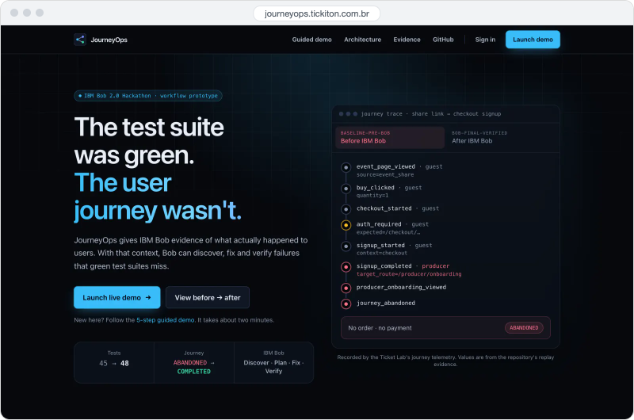</a>

**JourneyOps** 

O agente de IA recebe a jornada real do usuário em vez de um ticket e corrige o bug que a suíte de testes verde não pegava.

   

[Demo](https://journeyops.tickiton.com.br) · [Código](https://github.com/filpe19/journeyops)

</td>
</tr>
</table>

## Sistemas em produção

<table>
<tr>
<td width="50%" valign="top">

<a href="https://tickiton.com.br">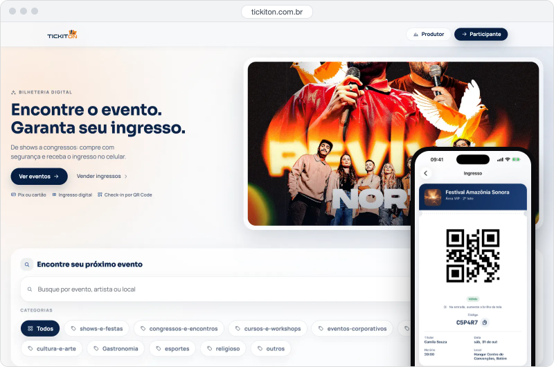</a>

### TickiTon

**Bilheteria e eventos · web e app iOS**

Checkout com reserva de estoque, Pix e cartão, ingresso com QR Code assinado, portaria que funciona sem internet e painel do produtor.

> 500 compradores disputando 300 vagas no teste de carga: 300 vendidas, nenhuma a mais.

     

[Site](https://tickiton.com.br) · [App Store](https://apps.apple.com/br/app/tickiton/id6824281845) · [Estudo de caso](https://github.com/filpe19/tickiton-case-study)

</td>
<td width="50%" valign="top">

<a href="https://acaifinance.com.br">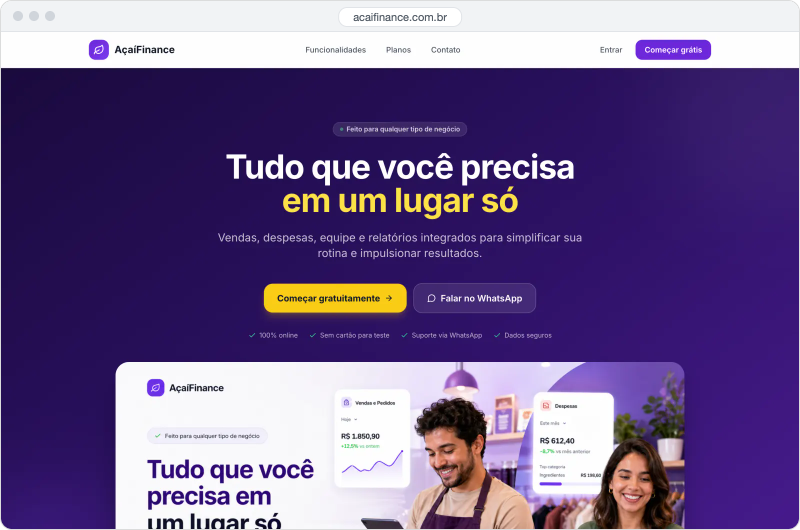</a>

### Açaí Finance

**SaaS multi-tenant e pagamentos**

Várias empresas de alimentação e varejo no mesmo sistema: catálogo, PDV, caixa, split de marketplace e carteira com ledger append-only.

> Migração do Google Cloud para VPS em 7 minutos de janela: resposta de 0,3–0,9 s para 0,13 s.

     

[Site](https://acaifinance.com.br) · [Estudo de caso](https://github.com/filpe19/acai-finance-case-study)

</td>
</tr>
<tr>
<td width="50%" valign="top">

<a href="https://assistenteia.online">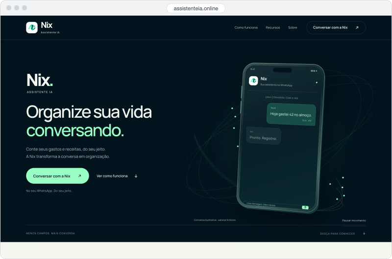</a>

### Nix

**Assistente financeiro com IA**

No WhatsApp e no Telegram: a pessoa conta o que gastou, por texto ou áudio, e recebe registro, relatórios, orçamentos e metas.

> O LLM só interpreta. Todo número sai de código determinístico, em centavos inteiros.

    

[Site](https://assistenteia.online) · [Estudo de caso](https://github.com/filpe19/finance-ai-case-study)

</td>
<td width="50%" valign="top">

<a href="https://apps.apple.com/br/app/clubpass-bel%C3%A9m/id6787500885">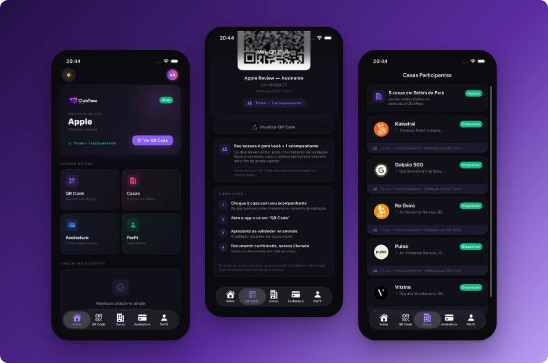</a>

### ClubPass Belém

**Assinatura e acesso por QR Code · app iOS**

Uma assinatura para casas parceiras da noite de Belém. Acesso liberado só com pagamento confirmado, QR que rotaciona e validação na porta.

> App nativo em SwiftUI com scanner AVFoundation para os validadores.

    

[App Store](https://apps.apple.com/br/app/clubpass-bel%C3%A9m/id6787500885) · [Estudo de caso](https://github.com/filpe19/club-pass-belem-case-study)

</td>
</tr>
<tr>
<td width="50%" valign="top">

<a href="https://jornadacontabilfiscal.com.br">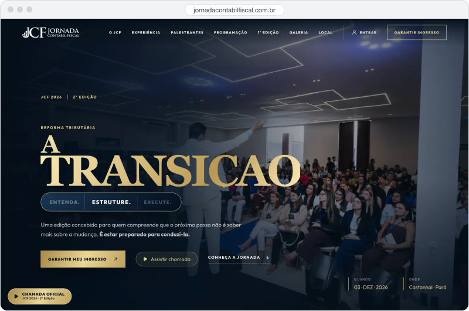</a>

### Jornada Contábil Fiscal

**Plataforma de evento**

Evento real da comunidade contábil: checkout com Asaas, portal do participante, check-in por QR, certificados e migração de dados legados.

> Inbox de eventos de pagamento com retry e runbooks para o dia do evento.

     

[Site](https://jornadacontabilfiscal.com.br) · [Estudo de caso](https://github.com/filpe19/jornada-contabil-case-study)

</td>
<td width="50%" valign="top">

### CRM Grupo Palace

**Operação comercial de consórcios**

CRM com pipeline, pós-venda, comissões e auditoria, landing page de captação e ranking de vendas ao vivo para a TV do escritório.

> Permissões por perfil decididas no backend e deploy por release com rollback.

     

[Landing page](https://landingpage.crmpalace.com)

</td>
</tr>
</table>

## Outros sistemas entregues

<table>
<tr>
<td width="33%" valign="top">

<a href="https://senshisushi.online/catalogo">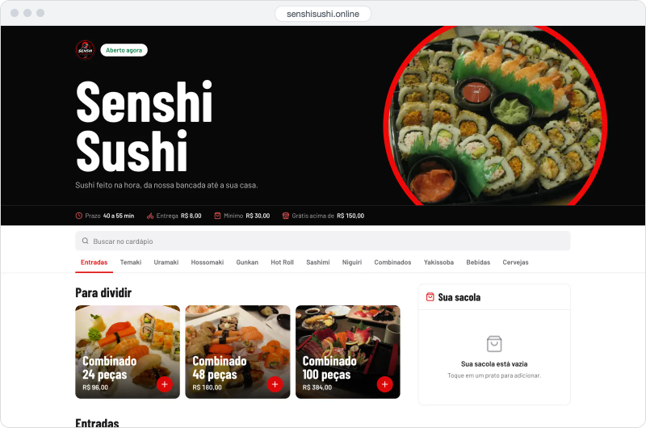</a>

**[Senshi Sushi](https://senshisushi.online/catalogo)** 
Garçom, cozinha, caixa, impressoras e maquininha Mercado Pago Point, mais catálogo online.

  

</td>
<td width="33%" valign="top">

<a href="https://urbanitariosdopara.org">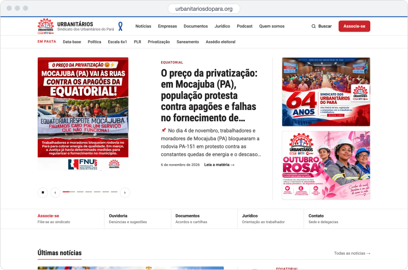</a>

**[Portal dos Urbanitários](https://urbanitariosdopara.org)** 
Do WordPress para Next.js e Payload CMS: 294 notícias e 1.310 anexos migrados.

  

</td>
<td width="33%" valign="top">

<a href="https://gamasilvaimoveis.com.br">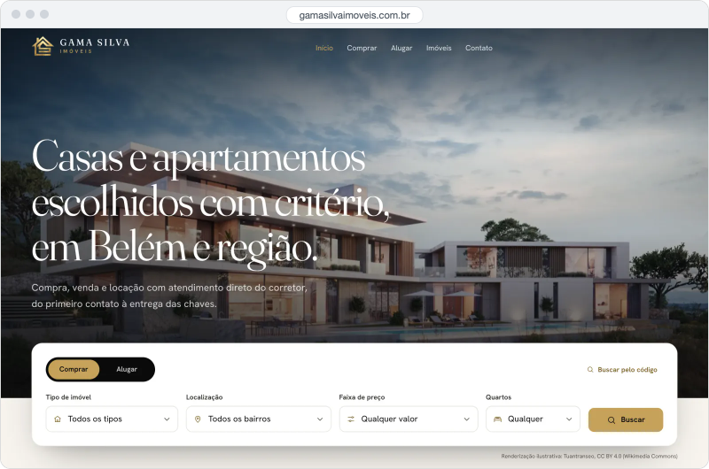</a>

**[Gama Silva Imóveis](https://gamasilvaimoveis.com.br)** 
Site imobiliário e painel de gestão, com métricas próprias sem cookies.

  

</td>
</tr>
<tr>
<td width="33%" valign="top">

<a href="https://rkstorys.com.br">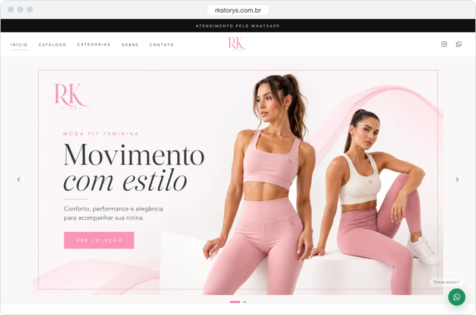</a>

**[RK Story](https://rkstorys.com.br)** 
Catálogo de moda com painel de gestão e atendimento pelo WhatsApp.

  

</td>
<td width="33%" valign="top">

<a href="https://zorgmed.com.br">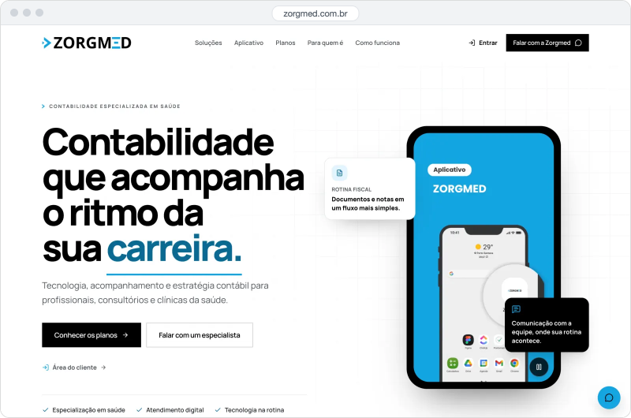</a>

**[Zorgmed](https://zorgmed.com.br)** 
Site institucional pré-renderizado para SEO, com deploy próprio.

  

</td>
</tr>
</table>

## Palestra

<table>
<tr>
<td width="45%" valign="top">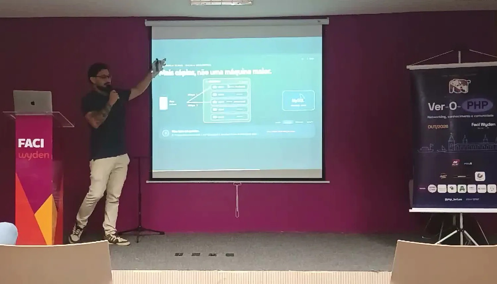</td>
<td valign="top">

### PHP aguenta o trampo?

**Ver-O-PHP**, comunidade PHP de Belém · novembro de 2026

A arquitetura real da TickiTon no palco: três portas de pagamento com uma única tranca, QR assinado com portaria offline e o laboratório de carga que mostrou onde estava o gargalo. No banco, não na linguagem.

</td>
</tr>
</table>

## Stack

<table>
<tr><td><b>Backend</b></td><td>     </td></tr>
<tr><td><b>Frontend</b></td><td>     </td></tr>
<tr><td><b>Mobile</b></td><td>  </td></tr>
<tr><td><b>Dados</b></td><td>   </td></tr>
<tr><td><b>Pagamentos e mensageria</b></td><td>   </td></tr>
<tr><td><b>Infra e qualidade</b></td><td>      </td></tr>
</table>

## Como eu trabalho

- **Pagamentos que não perdem dinheiro.** Pix, cartão, assinatura, maquininha e split de marketplace. Valor e taxa calculados no servidor, webhook tratado como evento repetível.
- **Transações sob concorrência.** Reserva atômica de estoque, ingresso emitido só após pagamento confirmado e testes de carga com invariantes em SQL.
- **Autorização no backend.** Tenant, perfil e assinatura decididos no servidor. O frontend só reflete.
- **IA com os pés no chão.** O modelo entende linguagem natural e voz; números vêm de código que dá para testar.
- **Deploy com volta garantida.** Release atômica com rollback, backup antes de migration e runbooks escritos antes do dia do evento.

## Contato

